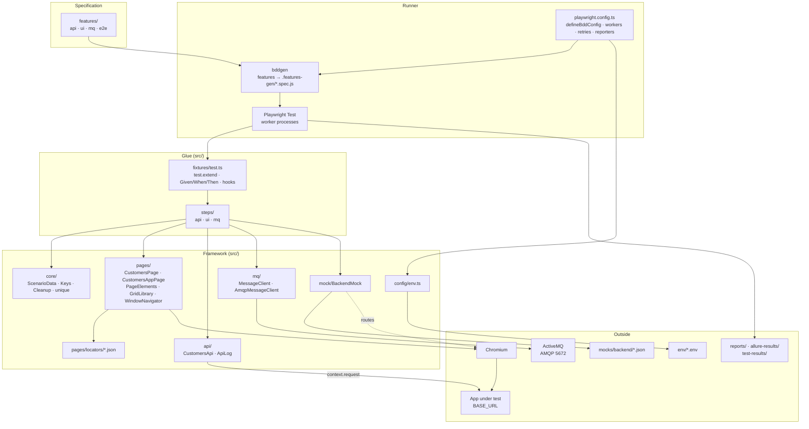
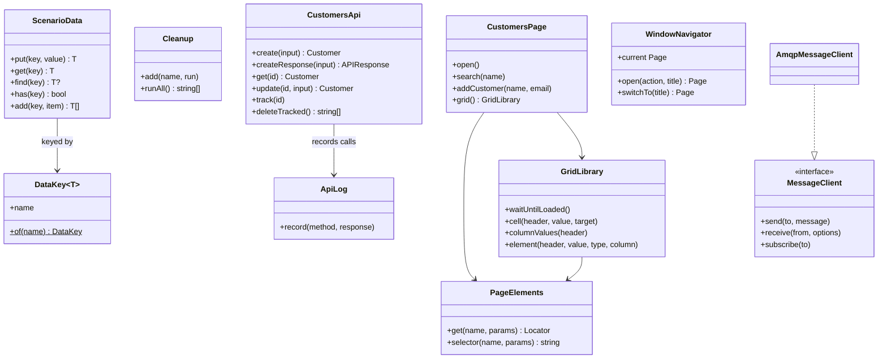
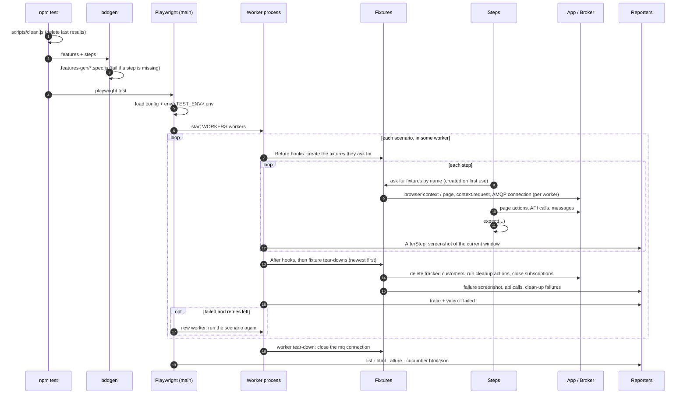
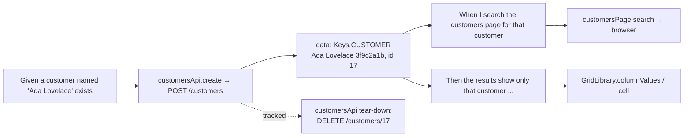

# Architecture and workflow

How the framework is built, how its parts fit together, and what happens from `npm test` to the reports. For the
Java framework's names for each part, see [java-equivalents.md](java-equivalents.md).

## Design principles

1. **One scenario, its own objects.** Everything a scenario uses (browser context, pages, data, API client,
   mocks) is a fixture created for that scenario only. That is what makes parallel runs safe.
2. **Feature files describe behaviour, TypeScript describes how.** Steps read like requirements. Selectors live
   in locator files, HTTP calls in API clients, broker details in the message client, each in one place.
3. **GUI and API share one browser context.** API calls use `context.request`, so they share cookies and
   session with the GUI steps, and share data with them through `data`.
4. **Pay only for what you use.** A fixture is created only when a step asks for it: API scenarios open no
   page, MQ scenarios start no browser, GUI-only workers never connect to the broker.
5. **Config, not code, for environments.** URLs, waits, workers, retries and the broker come from
   `env/<TEST_ENV>.env` and can be overridden by environment variables.
6. **Failures carry their evidence.** Screenshots, trace, video and API calls are attached automatically.
7. **Tests clean up after themselves**, pass or fail, and their data never clashes with other scenarios.

## Layers

| Layer | Folder | Responsibility |
|---|---|---|
| Specification | `features/` | what is tested, in Gherkin, tagged `@api`, `@ui`, `@mq`, `@e2e`, `@mock`, `@smoke` |
| Runner config | `playwright.config.ts` | where features and steps are, workers, retries, timeouts, browser options, reporters |
| Generation | `bddgen` → `.features-gen/` | one Playwright test file per feature; fails on a step with no definition |
| Fixtures and hooks | `src/fixtures/test.ts` | every fixture (set-up, tear-down), the step functions, the `AfterStep` screenshot |
| Steps | `src/steps/` | turn Gherkin into calls on page objects, API clients and the message client; no selectors, no URLs |
| Scenario data | `src/core/` | `ScenarioData` + `Keys` (typed shared data), `Cleanup`, unique names |
| GUI | `src/pages/` | page objects, locator files, grids, windows |
| API | `src/api/` | API clients on `context.request`, the API call log |
| Messaging | `src/mq/` | the `MessageClient` interface and its AMQP 1.0 implementation |
| Mocking | `src/mock/`, `mocks/` | backend mocks for frontend tests |
| Config | `src/config/env.ts`, `env/` | typed settings from env files and environment variables |

## Key components

## Workflow: what happens on `npm test`

### Scenario lifecycle in words

1. **Generation.** `bddgen` reads `features/**/*.feature` and the step files listed in `steps`, and writes one
   test file per feature to `.features-gen/`. Each scenario becomes a `test(...)` that calls the matching step
   functions with the arguments from the Gherkin.
2. **Scheduling.** `fullyParallel: true` makes every scenario its own test. Playwright hands them to `WORKERS`
   worker processes; a worker runs one scenario at a time.
3. **Wiring.** When a hook or step needs a fixture, Playwright creates it and everything it depends on, once per
   scenario. `mq` and `browser` are created once per worker.
4. **Before.** `Before` hooks run (the framework has none by default).
5. **Steps.** Steps call page objects, API clients and the message client, and store what later steps need in
   `data`. After each step the `AfterStep` hook screenshots the current window, if a page is open.
6. **After.** `After` hooks run. Then the fixtures are torn down, newest first and never before what they depend
   on: the failure screenshot is taken while the page is open, customers are deleted while the context still has
   the session, then the context closes and Playwright keeps the trace and video if the scenario failed.
7. **Retry.** A failed scenario with retries left runs again in a new worker, with new fixtures.
8. **Reporting.** The reporters receive every step, attachment and result as the run goes, and write their
   reports at the end.

### Data flow in a mixed scenario

The API call and the page use the same browser context, so if the app needed a login, one login would cover both.

## Extension points

| You want to… | Change |
|---|---|
| test a new endpoint | a method on the API client in `src/api/`, then a step |
| talk to a new service | a client class in `src/api/`, a fixture in `fixtures/test.ts`, steps in `src/steps/api/` ([api.md](api.md)) |
| test a new page | `src/pages/locators/<page>.json`, a page object, a fixture, steps ([page-objects.md](page-objects.md)) |
| a new kind of grid | a `grid.<name>.json` locator file ([page-objects.md](page-objects.md#grids-gridlibrary)) |
| share a new value between steps | a key in `Keys` ([keys.md](keys.md)) |
| clean up a new kind of resource | `cleanup.add(...)` in the step, or a tear-down in its fixture |
| a before/after action | a fixture tear-down, or a hook ([hooks.md](hooks.md)) |
| mock a backend endpoint | a file in `mocks/backend/` ([backend-mock.md](backend-mock.md)) |
| a new environment | `env/<name>.env` and `TEST_ENV=<name>` ([running-tests.md](running-tests.md#adding-an-environment)) |
| a new report | a reporter in `playwright.config.ts` ([reporting.md](reporting.md)) |
| another browser | a project in `projects: [...]`, for example `{ name: 'firefox', use: { browserName: 'firefox' } }` |

## Known limits

- **No self-healing locators and no `${variables}` in features**, unlike the Java framework.
- **One browser per worker process.** Scenarios are isolated by browser contexts; a browser crash fails the
  scenario running in it, and the next scenario in that worker gets a new browser.
- **Routing does not cover `context.request`.** Backend mocks apply to the browser only; API steps always reach
  the real backend.
- **Reading a queue consumes it.** Use `a new queue` or a selector when other runs share the broker
  ([messaging.md](messaging.md#isolation)).
- **Only Chromium is configured.** Other browsers need a project in the config and `npx playwright install`.
