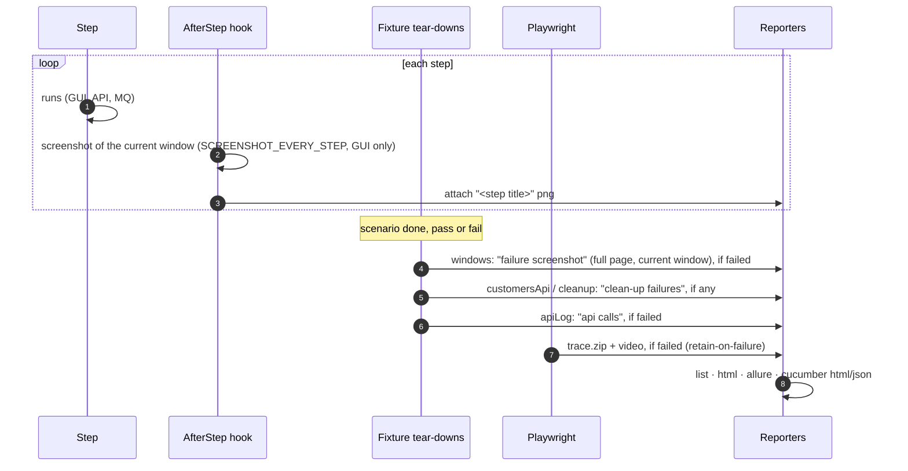

# Reporting

Every run produces three reports from the same results, and every failed scenario carries its own evidence. No
step has to collect anything.

## Output at a glance

| Output | Where | Made by | Open with |
|---|---|---|---|
| console | — | `list` reporter | — |
| Playwright HTML report | `reports/html/` | `html` reporter | `npm run report:html` |
| Allure results | `allure-results/` | `allure-playwright` | `npm run allure:serve` |
| Allure static report | `reports/allure/` | `npm run allure:generate` | `npm run allure:open` |
| Cucumber HTML | `reports/cucumber/report.html` | `cucumberReporter('html')` | a browser |
| Cucumber JSON | `reports/cucumber/report.json` | `cucumberReporter('json')` | tools that read Cucumber JSON (Jira/Xray, ...) |
| traces, videos, screenshots of failed scenarios | `test-results/<test>/` | Playwright | the HTML report, or `npx playwright show-trace <zip>` |

All of these are deleted at the start of `npm test` (see [running-tests.md](running-tests.md#clean-results-before-each-run)),
and none is committed.

## Complete flow



## Per scenario: what gets attached

| Attachment | When | From |
|---|---|---|
| a screenshot after each step, named by the step | `SCREENSHOT_EVERY_STEP=true` and the scenario has a page open | `AfterStep` hook in `fixtures/test.ts` |
| `failure screenshot` (full page) | failed, and a page was opened | `windows` fixture tear-down |
| `api calls`: every request with status and body | failed, and the scenario made API calls | `apiLog` fixture tear-down |
| `clean-up failures` | a clean-up action or a delete failed | `cleanup` and `customersApi` tear-downs |
| trace | failed (`trace: 'retain-on-failure'`) | Playwright |
| video | failed (`video: 'retain-on-failure'`) | Playwright |

Screenshots are of the window the scenario **is on** (`ui.current`), not always the first page. That is why
Playwright's own `screenshot` option is `off` in the config: it only captures the first page.

API and MQ scenarios get no screenshots: the hook asks for `ui`, which stays empty without a page.

### The trace

The trace is the most useful piece for a failed GUI scenario: every action with a before/after DOM snapshot,
the network calls, console messages and the source line. Open it from the HTML report, or with
`npx playwright show-trace test-results/<test>/trace.zip`.

## Compared with the Java framework

| Java | Here |
|---|---|
| `TestInitializeHooks` screenshot on failure | `windows` tear-down |
| trace saved in `closeBrowser` if failed | `trace: 'retain-on-failure'` |
| video `ui.video=failed` | `video: 'retain-on-failure'` |
| heal events attached | — (no self-healing) |
| `RunSummaryPlugin` → `run-summary.html` / `.json`, `[REPORT]` line | Playwright `list` + HTML report |
| Allure (`allure-cucumber`) | Allure (`allure-playwright`) |
| Extent | — |
| Cucumber `html` / `json` plugins | `cucumberReporter('html' / 'json')` from playwright-bdd |
| `failed-scenarios.txt` | `npx playwright test --last-failed` |
| `job_summary.py` (GitHub summary) | not built |

## Allure

`allure-playwright` is configured in [playwright.config.ts](../playwright.config.ts):

```ts
['allure-playwright', { resultsDir: 'allure-results', detail: true, suiteTitle: true,
  environmentInfo: { env: env.name, baseUrl: env.baseUrl } }],
```

- Every Gherkin step is an Allure step; attachments show under the step or the test.
- `environmentInfo` puts the environment name and base URL on the overview page.
- Retries are shown as retries of one test, not as separate tests.
- `allure:serve` builds a temporary report and opens it; `allure:generate` + `allure:open` makes a static one
  in `reports/allure` (needs Java, which `allure-commandline` uses).

## Retries in the reports

With `RETRIES` > 0, a scenario that fails and then passes is reported as **flaky** in the Playwright report and
the console summary. Each attempt keeps its own attachments.

## Adding to the reports

- **An attachment from a step:** ask for `$testInfo` in a hook, or use `testInfo` in a fixture:
  `await testInfo.attach('order', { body: JSON.stringify(order, null, 2), contentType: 'application/json' })`.
- **A reporter:** add it to `reporter: [...]` in `playwright.config.ts`, for example `['junit', { outputFile: 'reports/junit.xml' }]`.
